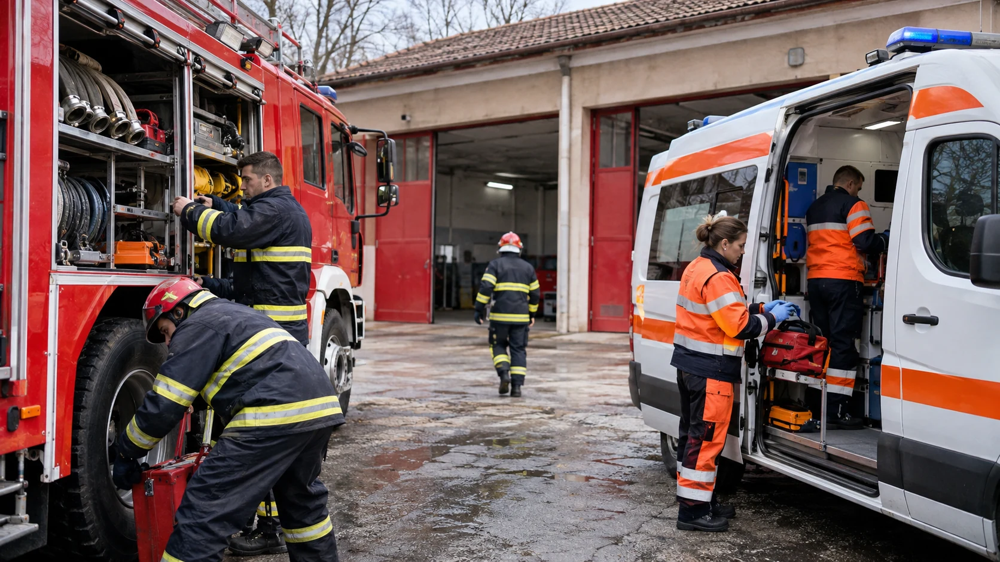

# Pompierii teleormăneni au intervenit la 55 de urgențe în 72 de ore — datele oficiale

Intervențiile au inclus cinci incendii și trei accidente rutiere. O parte importantă a solicitărilor a fost reprezentată de cazurile medicale preluate de echipajele SMURD. ISU Teleorman a consemnat 55 de situații de urgență gestionate în 72 de ore de pompieri și echipajele de prim ajutor.

Pompierii le recomandă verificarea instalațiilor de încălzire și electrice și apelarea numărului 112 numai pentru situații care necesită intervenție imediată. Informația privește direct comunitățile din Teleorman.

## Surse

- https://isutr.igsu.ro/comunicate-de-presa/in-ajutorul-cetatenilor-la-55-de-situatii-de-urgenta-943
