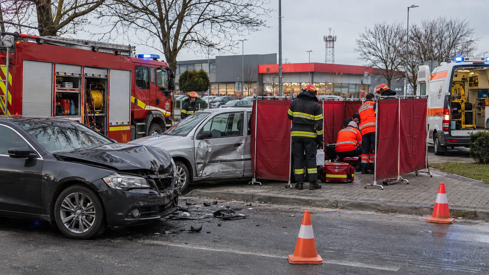

# Coliziune între două mașini în zona comercială din Alexandria

Potrivit instituției, echipajele au fost trimise după ce apelantul a indicat că mai multe persoane ar putea fi rănite sau blocate în vehicule.

## Datele comunicate de instituție

Separat, comunicatul precizează că două persoane au primit primul ajutor. ISU Teleorman nu a indicat în comunicat cauza producerii coliziunii.

Din punct de vedere practic, accidentul a fost anunțat la 112 în zona comercială a municipiului Alexandria și a implicat două autoturisme.

## Surse

- https://isutr.igsu.ro/comunicate-de-presa/doua-persoane-au-primit-primul-ajutor-941
