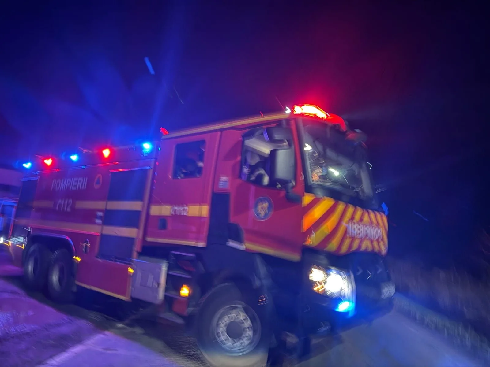

# Băcălești și Măldăeni: două persoane asistate după incendii de locuință

Două incendii izbucnite în seara de 9 noiembrie la Băcălești și Măldăeni au mobilizat pompierii din Roșiorii de Vede. În primul caz, proprietarul a refuzat transportul; în al doilea, o persoană a ajuns la spital.

## Pagubele și victima din Măldăeni

Proprietarul din Băcălești a primit îngrijiri de la SMURD, dar a refuzat transportul la spital; cauza probabilă indicată este fumatul în locuri nepermise. Incendiul din Băcălești a ajuns să fie anunțat în jurul orei 19:30 și a afectat o saltea și tocul unei uși. O persoană din Măldăeni a ajuns să fie preluată de SAJ și transportată la spital.

## Intervenția din Băcălești

În Măldăeni, alarma a ajuns să fie dată în jurul orei 20:00, iar focul a distrus mobilier și aparate din două camere. Pentru incendiul din Măldăeni, cauza probabilă a ajuns să fie jarul căzut din sobă pe materiale combustibile.

## Surse

- https://isutr.igsu.ro/comunicate-de-presa/doua-incendii-de-locuinta-in-localitatile-bacalesti-si-maldaeni-937

