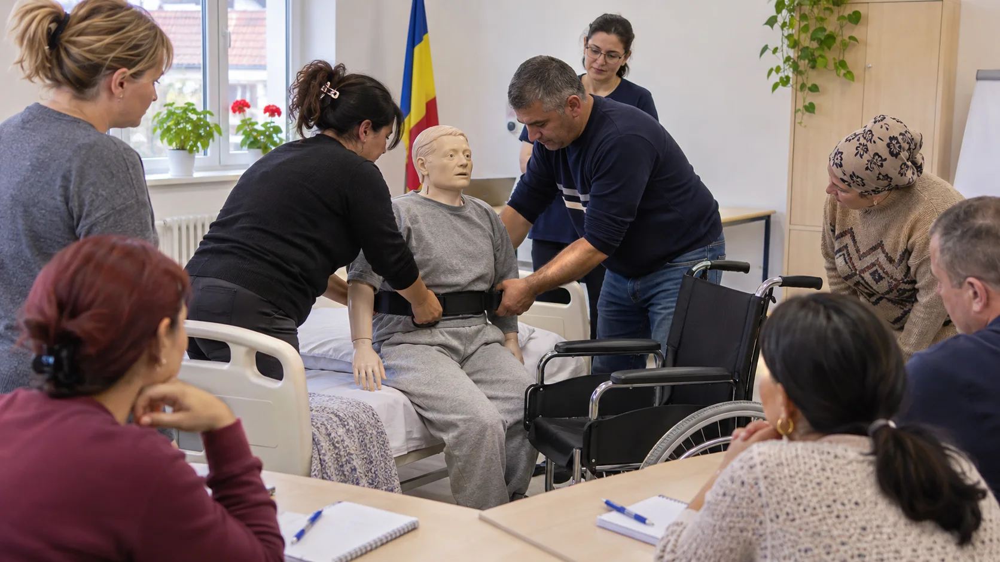

Persoanele interesate de calificarea ca asistent personal profesionist pot transmite intenția de participare până la 25 noiembrie; cursurile sunt planificate în 2027.

## Datele comunicate public

Termenul pentru exprimarea interesului este 25 noiembrie 2026. Anunțul indică pentru informații numărul 0733 313 409; înscrierea finală depinde de verificarea documentelor și a condițiilor proiectului.

Cursurile sunt planificate pentru 2027 și pot avea format hibrid. Candidații trebuie să aibă cel puțin 18 ani, minimum opt clase absolvite și o adeverință medicală; soțul, soția și rudele în linie directă ale persoanei asistate nu pot avea această calitate.

**Sursa informațiilor:** [https://www.primariarosioriidevede.ro/index.php/ro/component/content/article/9-anunturi/873-anunt-privind-programul-gratuit-de-calificare-asisitent-personal-profesionist-app?Itemid=101](https://www.primariarosioriidevede.ro/index.php/ro/component/content/article/9-anunturi/873-anunt-privind-programul-gratuit-de-calificare-asisitent-personal-profesionist-app?Itemid=101)
