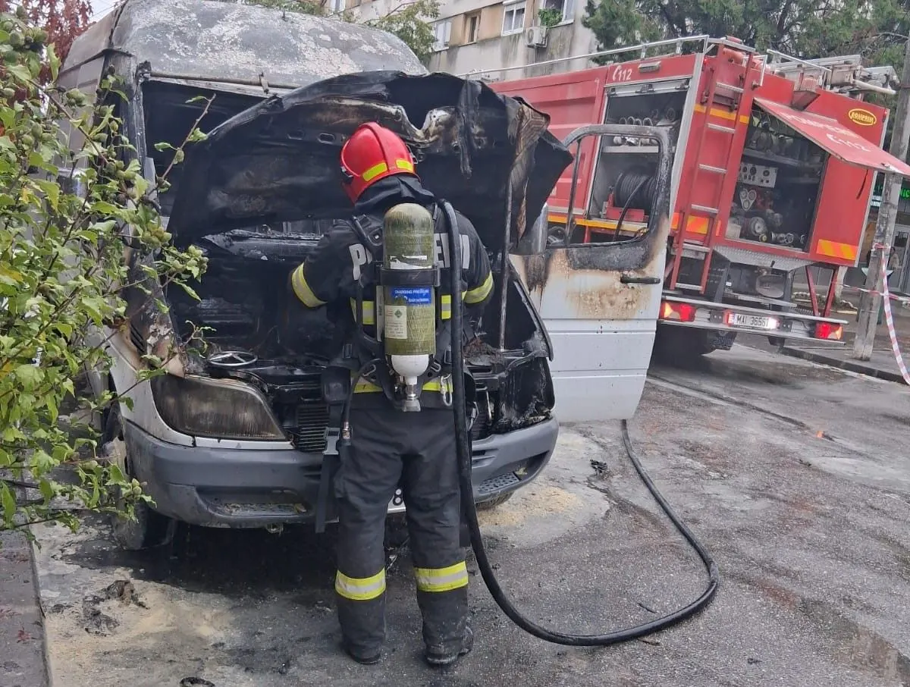

# Date oficiale: autoutilitară distrusă aproape complet de un incendiu la Roșiorii de Vede

*Imagine publicată de instituția care a emis informarea.*

Inspectoratul pentru Situații de Urgență „Alexandru Dimitrie Ghica” al județului Teleorman Informația apare în comunicarea oficială a IGSU.

## Informațiile esențiale

Documentul oficial mai precizează că iNSPECTORATUL PENTRU SITUAȚII DE URGENȚĂ „ALEXANDRU DIMITRIE GHICA” AL JUDEȚULUI TELEORMAN

Instituția consemnează că cu puțin timp în urmă, o autoutilitară a fost cuprinsă de flăcări pe strada Mărășești din municipiul Roșiorii de Vede. Din fericire, evenimentul nu s-a soldat cu victime, însă autovehiculul a fost distrus în proporție de aproximativ 90%.

## Detaliile comunicate de instituție

## Surse

- [Sursa oficială](https://isutr.igsu.ro/comunicate-de-presa/autoutilitara-cuprinsa-de-flacari-in-rosiorii-de-vede-929)
