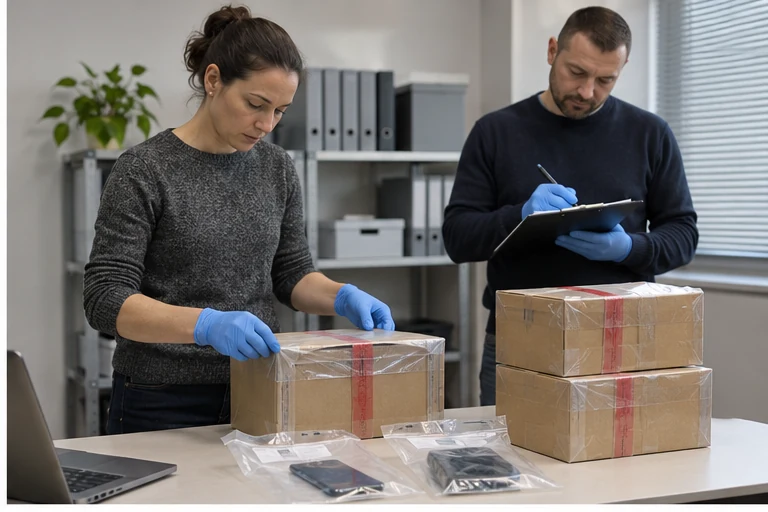

# Percheziții într-un dosar privind pornografia infantilă în Teleorman — datele oficiale

Pentru publicul din Teleorman, datele oficiale relevante sunt următoarele. Detaliile care ar putea identifica victimele nu trebuie publicate sau distribuite. Cercetarea continuă sub coordonarea procurorului.

Anchetatorii au desfășurat activități într-un dosar privind posibila producere, deținere ori distribuire de materiale cu abuz sexual asupra minorilor.

Persoanele vizate beneficiază de prezumția de nevinovăție, iar orice suspiciune de exploatare a unui copil trebuie sesizată autorităților.

## Surse

- https://tr.politiaromana.ro/ro/stiri-si-media/stiri/persoane-cercetate-pentru-pornografie-infantila
