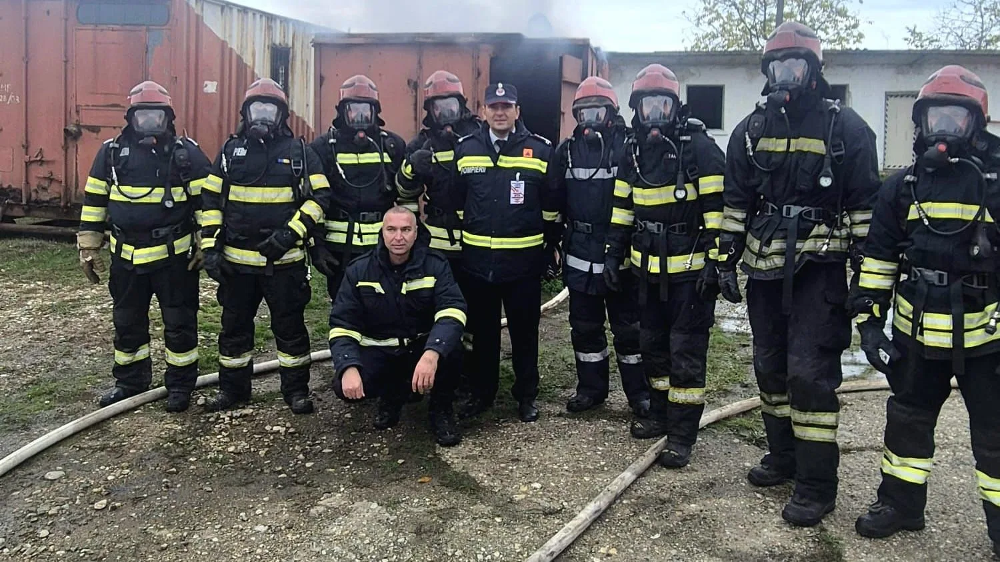

# Flashover, backdraft și rollover, simulate în poligonul pompierilor din Videle

Poligonul de pregătire din Videle a găzduit exerciții comune privind fenomenele flashover, backdraft și rollover, care pot schimba brusc evoluția unui incendiu.

## Fenomenele simulate în poligon

Pregătirea a ajuns să fie coordonată de instructori ai ISU Dolj și ISU Teleorman. Au participat cinci pompieri bulgari, cinci de la ISU Olt și cinci de la ISU Teleorman.

## Cine a participat la exercițiu

Participanții au exersat evaluarea condițiilor, alegerea tehnicilor de stingere și măsurile de protecție. Exercițiile au urmărit recunoașterea fenomenelor flashover, backdraft și rollover.

## Surse

- https://isutr.igsu.ro/comunicate-de-presa/pregatire-comuna-la-videle:-pompierii-romani-si-bulgari-si-au-perfectionat-tehnicile-de-interventie-la-incendii-931
