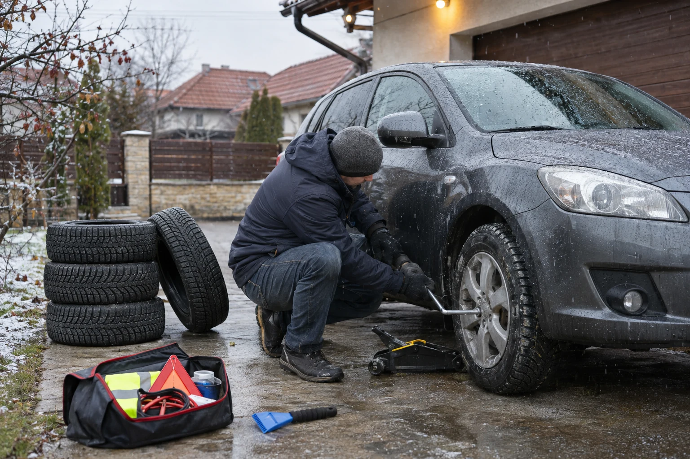

# Teleorman: ce trebuie verificat la mașină înainte de prima ninsoare. Datele confirmate de autorități

Mesajul preventiv transmis de IGSU pentru sezonul rece este valabil și în Teleorman, de la alegerea anvelopelor până la echipamentul păstrat în mașină.

Pompierii recomandă montarea anvelopelor de iarnă înaintea apariției zăpezii și a poleiului.

Verificările indicate privesc bateria, frânele, luminile și lichidul de parbriz potrivit temperaturilor scăzute.

## Ce au comunicat autoritățile

În mașină ar trebui păstrate o lopată, o racletă, o lanternă și o pătură pentru situațiile în care deplasarea este întreruptă. Viteza trebuie redusă la starea carosabilului, iar distanța față de vehiculul din față mărită.

## Surse

- https://www.igsu.ro/comunicate-de-presa/nu-astepta-prima-ninsoare!-preventia-nu-tine-de-vreme.-tine-de-tine.-4295
