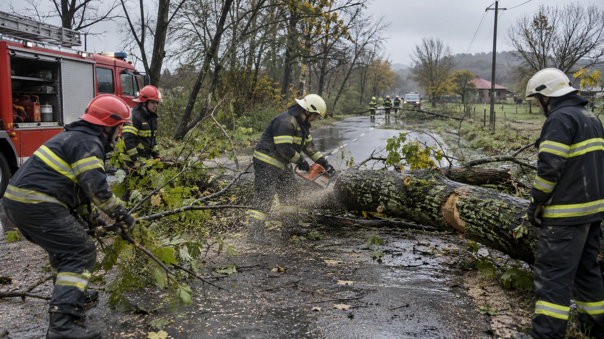

# Teleorman: vântul puternic a produs efecte în Teleorman

Actualizarea publicată de instituția competentă privește direct județul Teleorman.

La nivelul celor 81 de localități afectate, salvatorii au evacuat apă din trei curți și un beci, au îndepărtat elemente desprinse de pe 11 acoperișuri și au degajat 88 de copaci și șase stâlpi de electricitate. Cinci autovehicule au fost avariate, fără victime sau persoane rănite.

În paralel, pompierii au stins 40 de incendii, au răspuns la aproximativ 1.400 de solicitări de prim ajutor și au desfășurat 220 de misiuni pentru protecția comunităților. IGSU precizează că 19 persoane aflate în situații critice au fost salvate.

Recomandarea pentru locuitorii din Teleorman este să evite copacii, stâlpii și panourile instabile, să nu atingă firele electrice căzute și să limiteze activitățile în aer liber pe durata avertizărilor.

IGSU a inclus județul Teleorman între cele 24 de județe, alături de municipiul București, în care au fost raportate efecte ale vântului puternic în intervalul 19 noiembrie, ora 08:00 – 20 noiembrie, ora 08:00. Informațiile ulterioare trebuie urmărite prin canalele oficiale ale instituției.

## Surse

- https://www.igsu.ro/comunicate-de-presa/bilantul-misiunilor-desfasurate-de-salvatori-in-ultimele-24-de-ore-4309
