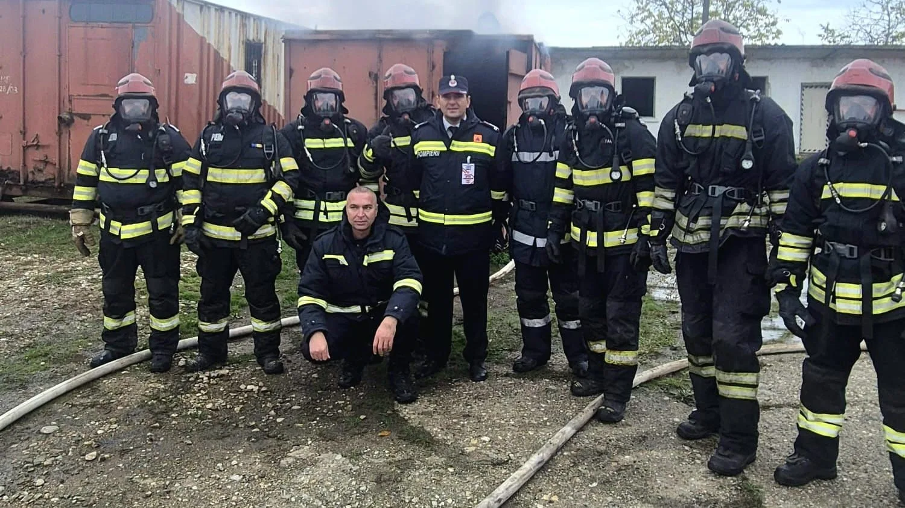

# Incendiu la un autovehicul și intervenții la accidente, în bilanțul ISU Teleorman

Un incendiu izbucnit la un autovehicul, mai multe accidente și solicitările pentru prim ajutor se numără printre cele 40 de intervenții ale pompierilor teleormăneni din ultimele două zile.

Inspectoratul arată că operațiunile au avut ca obiect protejarea persoanelor și limitarea pagubelor. Cauza incendiului auto și localitățile în care s-au produs accidentele nu sunt detaliate în comunicat.

## Șase controale preventive

În paralel, specialiștii ISU au verificat șase obiective. Au fost analizate măsurile de prevenire și stingere a incendiilor, iar neregulile au fost sancționate. Instituția nu a publicat cuantumul total al amenzilor.

## Surse

- https://isutr.igsu.ro/comunicate-de-presa/40-de-interventii-ale-pompierilor-teleormaneni-si-sase-controale-pentru-prevenirea-incendiilor-in-ultimele-48-de-ore-939
