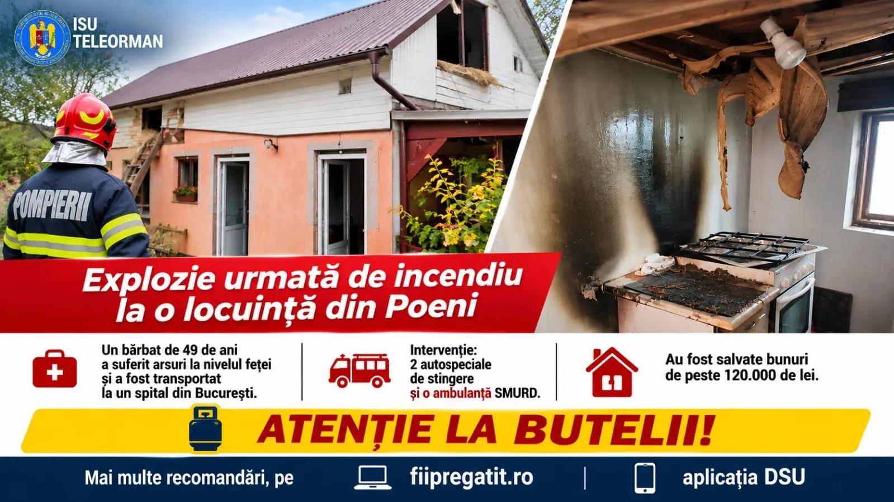

Bilanțul instituției fixează un reper important: 

# Intervenții pe E70 și în Alexandria: trei răniți transportați la spital

În documentul oficial apare și următorul element: pompierii teleormăneni au intervenit la trei accidente rutiere între 6 și 9 noiembrie.

## Calendar și consecințe

Pentru înțelegerea consecințelor locale, trebuie reținut că în Alexandria, două mașini s-au ciocnit pe strada Alexandru Ghica, iar un bărbat de circa 50 de ani a ajuns la spital.

## Ce rămâne de clarificat

Separat de acest aspect, datele verificate arată că la Peretu, un tânăr de aproximativ 20 de ani și o femeie de 44 de ani au fost extrași dintr-un autoturism avariat și duși la spital.

## Ce s-a întâmplat

În etapa actuală, informația confirmată este că bilanțul de 72 de ore cuprinde 60 de urgențe, inclusiv un incendiu de locuință și o intervenție la un vagon-cisternă cu scurgere de carburant.

## Surse

- https://isutr.igsu.ro/comunicate-de-presa/jurnalul-operativ-al-pompierilor-teleormaneni-936
- https://isutr.igsu.ro/comunicate-de-presa/un-barbat-a-ajuns-la-spital-in-urma-unui-accident-rutier-produs-in-alexandria-935
- https://isutr.igsu.ro/comunicate-de-presa/doua-persoane-ranite-intr-un-accident-rutier-pe-e70-in-localitatea-peretu-934

