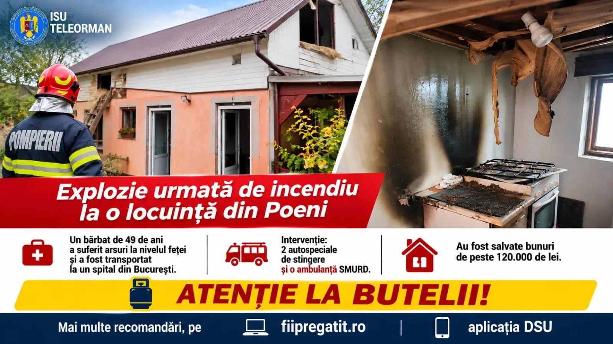

# Islaz: jar de la sobă a aprins bucătăria; bilanț 43 misiuni în județ

Luni, 2 noiembrie, o locuință din Islaz a fost afectată de un incendiu pornit din bucătărie, când jarul unei sobe supraîncărcate a aprins materiale inflamabile. ISU Teleorman încadrează evenimentul într-un bilanț de 43 de misiuni în 48 de ore, cu intervenții medicale, efecte ale vremii și controale cu amenzi în tot județul.

## Cum a evoluat focul la Islaz

Au fost distruse mobilier, aparate electrocasnice și o butelie de gaz. Pagubele sunt estimate la circa 10.000 de lei. Inspectoratul notează că propagarea a fost oprită la timp, protejând bunuri de valoare cumulată de peste 100.000 de lei.

Voluntarii SVSU Islaz au localizat incendiul până la sosirea a două echipaje din Turnu Măgurele, cu câte o autospecială de apă și spumă. Anunțul include recomandări oficiale privind sobă și instalații de încălzire.

## Alexandria, Didești și restul misiunilor

Pe lângă cele trei incendii (două locuințe și un transformator electric), pompierii au acționat la patru arbori căzuți, trei evacuări de apă din curți și 32 de situații SMURD. A existat și sprijin pentru o persoană supraponderală, cu SAJ.

Inspecția de prevenire: șase controale, 19 sancțiuni, 23.000 de lei. În Alexandria și Didești, verificări la școli, lăcașe de cult și firme — inclusiv amendă de 20.000 de lei pentru lipsa autorizației PSI la un operator comercial/de depozitare, amenzi de câte 1.000 de lei pentru vânzători GPL fără împământare și pentru o școală fără verificare la protecția contra trăsnetului.

## Surse

- https://isutr.igsu.ro/comunicate-de-presa/43-de-misiuni-in-48-de-ore.-incendii-interventii-in-urma-vremii-nefavorabile-si-controale-de-prevenire-927
