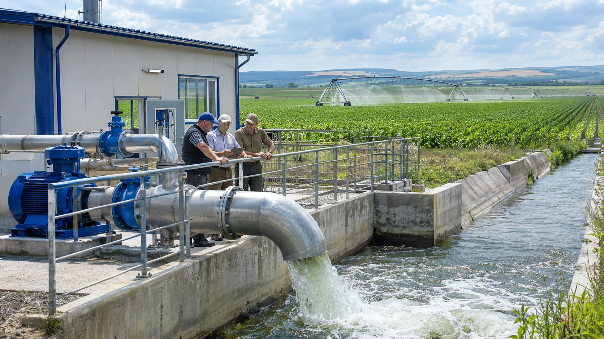

# Teleorman: finanțări noi pentru irigații în județul Teleorman

Actualizarea publicată de instituția competentă privește direct județul Teleorman.

Proiectele au trecut evaluarea, dar au rămas inițial fără finanțare. Sprijinul poate ajunge la 1,5 milioane de euro pentru fiecare beneficiar și acoperă integral cheltuielile eligibile.

Investițiile pot finanța modernizarea stațiilor de punere sub presiune, reabilitarea rețelelor de distribuție și lucrări la clădirile stațiilor. Peste 8.000 de hectare din Brăila, Buzău, Prahova și Teleorman sunt vizate.

AFIR urmează să publice lista de așteptare și, în cinci zile lucrătoare, raportul de selecție suplimentar, în limita sumelor disponibile.

Ministerul Agriculturii propune utilizarea a peste 15,1 milioane de euro pentru aproximativ zece proiecte de modernizare a infrastructurii de irigații, inclusiv în județul Teleorman. Informațiile ulterioare trebuie urmărite prin canalele oficiale ale instituției.

## Surse

- https://www.madr.ro/comunicare/peste-15-1-milioane-de-euro-pentru-modernizarea-irigatiilor-inca-10-proiecte-primesc-unda-verde-la-finantare.html
