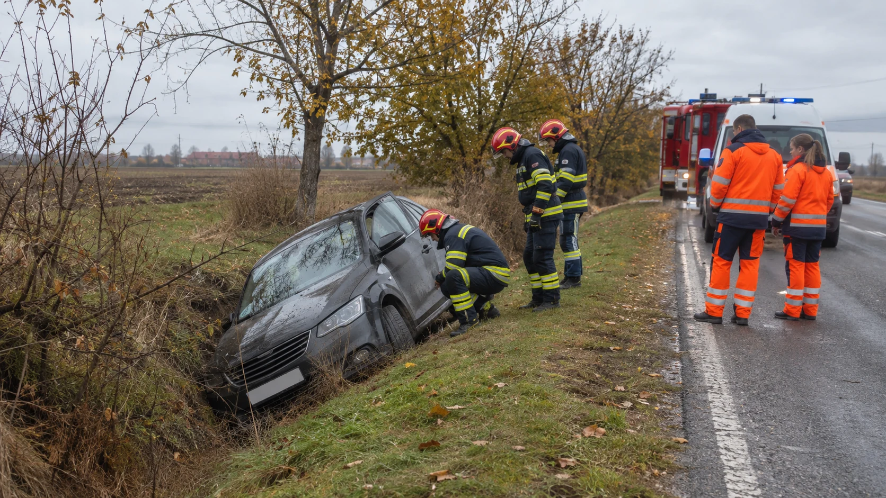

# Intervenție a salvatorilor după un accident la Măldăeni

Potrivit instituției, apelul inițial indica faptul că un autoturism se răsturnase în șanț și că șoferul ar putea fi încarcerat.

## Datele comunicate de instituție

Separat, comunicatul precizează că echipajele de salvare s-au deplasat pentru evaluarea persoanei și securizarea mașinii. Comunicatul publicat nu indică o cauză a accidentului.

Din punct de vedere practic, accidentul a fost semnalat în jurul orei 14:00 pe raza localității Măldăeni.

## Surse

- https://isutr.igsu.ro/comunicate-de-presa/s-a-rasturnat-cu-masina-in-sant-si-a-avut-nevoie-de-ajutorul-salvatorilor-942
