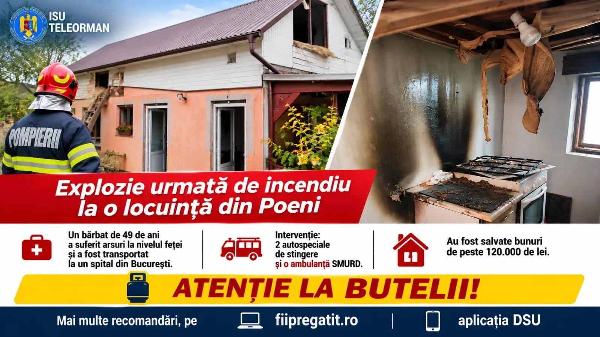

# Coliziune cu trei autovehicule pe E70, la Peretu: zero victime raportate

Un accident rutier în care au fost implicate trei autovehicule s-a produs pe 4 noiembrie 2026 pe DN E70, în Peretu, anunță inspectoratul de urgență al județului Teleorman. Bilanțul comunicat: nicio persoană rănită.

## Ce s-a trimis la fața locului

Două formații de intervenție — autospecială de stingere și echipaj SMURD — au fost mobilizate la coliziune. Militarii au menținut măsurile specifice de prevenire și stingere a incendiilor post-accident, procedură obișnuită când există risc la vehicule avariate.

Cercetarea cauzelor și a eventualelor responsabilități nu revine ISU; comunicatul arată că dosarul este la autoritățile competente, fără alte precizări despre încadrarea juridică.

## Trafic și mesaj oficial

Anunțul conține și îndemnuri pentru participanții la trafic să circule cu prudență. Pentru șoferii care tranzitează Teleormanul pe E70, inclusiv spre Alexandria sau spre granița cu Giurgiu, informația relevantă rămâne absența victimelor și faptul că echipajele au încheiat partea de urgență la fața locului.

Nu sunt menționate restricții de durată sau devieri oficiale de traseu în textul publicat de inspectorat.

## Surse

- https://isutr.igsu.ro/comunicate-de-presa/accident-rutier-cu-trei-autovehicule-implicate-pe-raza-localitatii-peretu-928
