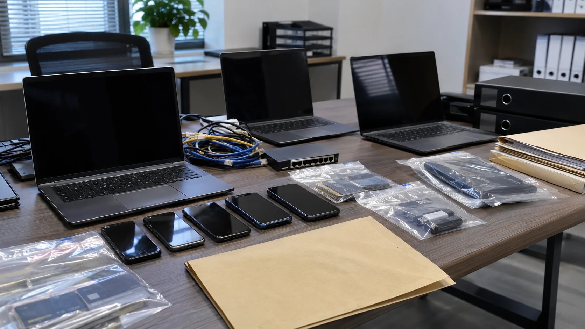

# Percheziții în Teleorman într-un dosar cu peste 100 de victime ale unor fraude online — ce arată comunicatul oficial în Teleorman

Pentru publicul din Teleorman, comunicatul instituției clarifică următoarele date.

Polițiștii BCCO Pitești și procurorii DIICOT au efectuat la 18 noiembrie cinci percheziții domiciliare în județul Teleorman. Peste 20 de persoane urmau să fie conduse la audieri.

După introducerea datelor de acces, conturile victimelor ar fi fost preluate și blocate, iar pentru recuperarea lor s-ar fi cerut bani. În dosar sunt peste 100 de persoane vătămate.

Anchetatorii susțin că, între septembrie 2024 și ianuarie 2025, aproximativ 30 de persoane ar fi constituit un grup organizat care distribuia linkuri false, asemănătoare unor pagini de marketplace sau rețele sociale.

Sumele obținute ar fi fost folosite inclusiv pentru cumpărarea de criptomonede. Cercetările vizează constituirea unui grup infracțional organizat, înșelăciune și spălarea banilor; persoanele cercetate beneficiază de prezumția de nevinovăție.

## Surse

- https://ag.politiaromana.ro/ro/stiri-si-media/stiri/comunicat-perchezitii-efectuate-de-politistii-bcco-intr-un-dosar-privind-constituirea-unui-grup-infractional-organizat-inselaciune-si-spalarea-banilor-18-noiembrie-2026
