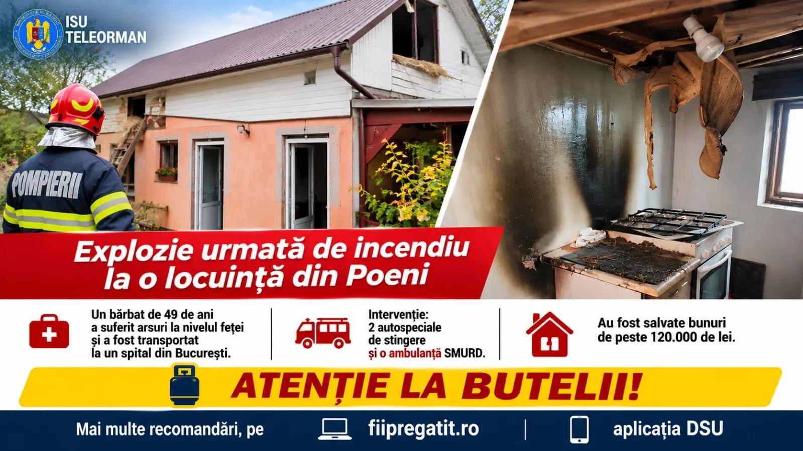

# Explozie la o casă din Poeni: victimă cu arsuri faciale

Un bărbat de aproape 49 de ani din Poeni a ajuns la un spital de specialitate din București cu arsuri la față, după o explozie urmată de incendiu la locuința sa, în jurul orei 11:30 pe 1 noiembrie 2026. Datele apar în comunicatul ISU Teleorman.

## Ora și locul intervenției

Evenimentul este localizat de ISU Teleorman în localitatea Poeni. Momentul comunicat: în jurul orei 11:30, pe 1 noiembrie 2026.

Secvența din anunț este clară: explozie, apoi incendiu la locuință. Proprietarul casei este victima menționată.

## Arsuri și spitalizare

Arsurile sunt raportate la nivelul feței. Transportul a fost către un spital de specialitate din București — formulare folosită de inspectorat.

## Limitele informației oficiale

Comunicatul nu enumeră autospecialele trimise, nu confirmă alte persoane rănite și nu avansează o cauză tehnică a exploziei.

Nu inventăm cauze, reacții ale vecinilor sau detalii medicale necomunicate. Presupunerea de nevinovăție nu este în discuție aici: anunțul este operațional, nu o acuzație penală.

## Surse

- https://isutr.igsu.ro/comunicate-de-presa/explozie-urmata-de-incendiu-la-o-locuinta-din-poeni.-un-barbat-a-suferit-arsuri-la-nivelul-fetei-924
