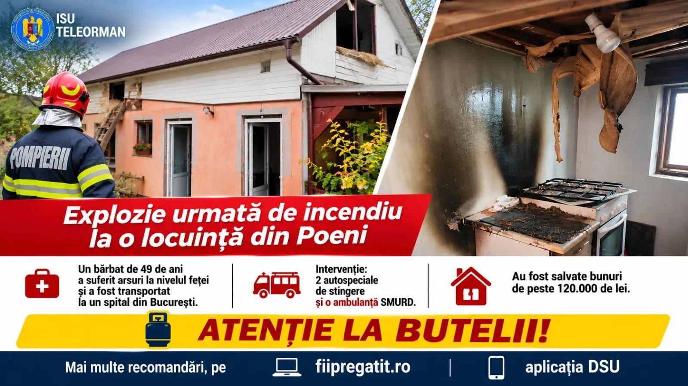

# Flăcări pe Mărășești, în Roșiorii de Vede: autoutilitară distrusă în proporție de 90%

Pe strada Mărășești din Roșiorii de Vede, o autoutilitară a luat foc. ISU Teleorman, în comunicatul nr. 300 din 4 noiembrie 2026, anunță că nu au existat victime, dar că vehiculul a fost distrus în proporție de aproximativ 90%.

Pompierii militari din Detașamentul Roșiorii de Vede au intervenit cu o autospecială de stingere și o ambulanță SMURD. Au acționat pentru stingere și pentru a preveni extinderea flăcărilor.

Cauza probabilă, potrivit inspectoratului: autoaprinderea unor materiale combustibile din cauza efectului termic al motorului. Comunicatul nu precizează ora exactă sau tipul autoutilitarei.

ISU Teleorman îndrumă publicul spre fiipregatit.ro și aplicația DSU pentru informații despre comportamentul în situații de urgență.

## Surse

- https://isutr.igsu.ro/comunicate-de-presa/autoutilitara-cuprinsa-de-flacari-in-rosiorii-de-vede-929
