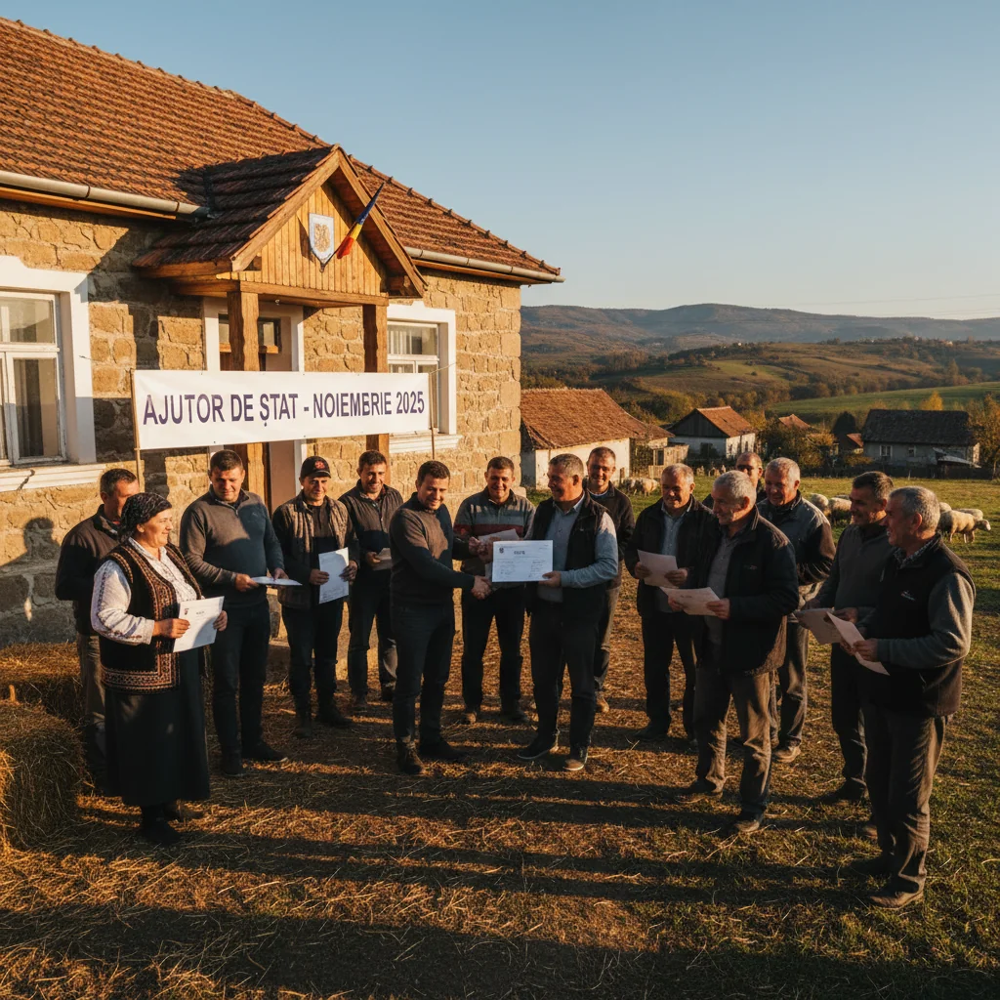

# Campanie gratuită de sterilizare a câinilor, organizată două zile la Roșiori de Vede

O nouă campanie de sterilizare gratuită a câinilor este programată la Roșiori de Vede pe 18–19 noiembrie. Organizatorii menționați de municipalitate sunt Primăria, Urbis Servconstruct Roșiori, Romania Animal Rescue și Center of Hope.

Anunțul oficial nu oferă, deocamdată, detalii despre locul intervențiilor, ore sau înscrieri. Cei interesați trebuie să verifice actualizările primăriei înainte de a se prezenta.

Campania acoperă ambele zile și nu este menționat un tarif pentru proprietari.

## Surse

- https://www.primariarosioriidevede.ro/index.php/ro/monitorul-oficial/9-anunturi/872-primaria-municipiului-rosiori-de-vede-in-parteneriat-cu-sc-urbis-servconstruct-rosiori-si-organizatiile-romania-animal-rescue-si-center-of-hope-anunta-desfasurarea-unei-noi-campanii-gratuite-de-sterilizare-a-cainilor-in-zilele-de-18-19-noiembrie-2026
