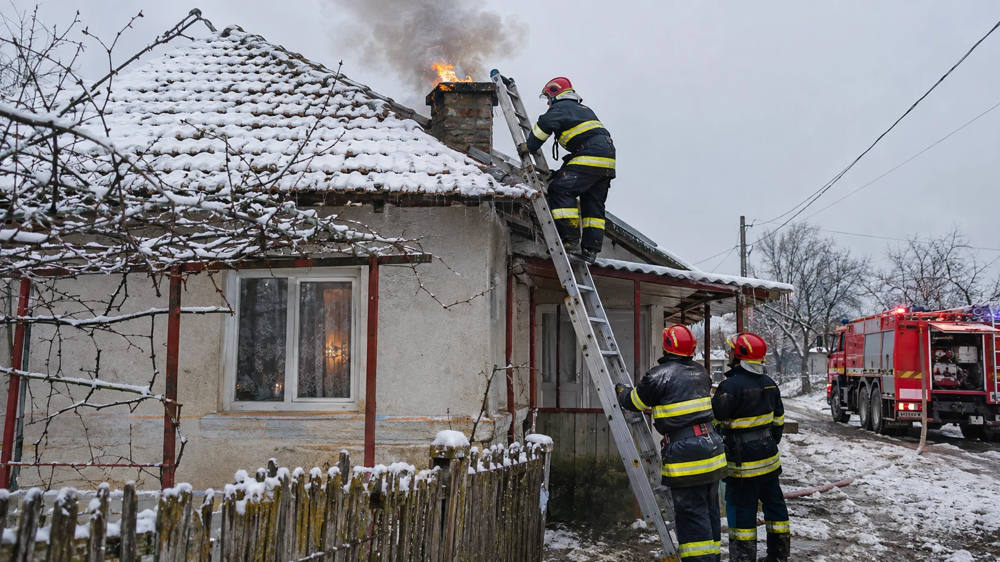

# Două incendii de locuință și un accident fără victime, în bilanțul ISU Teleorman

Cele două incendii de locuință, la Spătărei și Dracea, au avut drept cauză probabilă coșuri de fum neprotejate termic. Bilanțul și intervalul sunt cele precizate de ISU Teleorman.

## Ce a comunicat instituția

În același interval au fost îndepărtate un copac și un stâlp care generau pericol. Cauzele incendiilor sunt cele probabile stabilite operativ de pompieri și pot fi completate prin verificările specifice.

Echipajele SMURD au avut 17 misiuni, iar în alte trei cazuri au acordat sprijin Serviciului de Ambulanță Județean. Pe DJ503, în apropiere de Purani, pompierii au intervenit la un accident rutier fără victime.

## Pentru public

Informația rămâne valabilă în limitele comunicate de ISU Teleorman; eventualele schimbări trebuie verificate direct la instituție.

## Surse

- https://isutr.igsu.ro/comunicate-de-presa/27-de-interventii-in-sprijinul-cetatenilor-in-ultimele-24-de-ore-955
