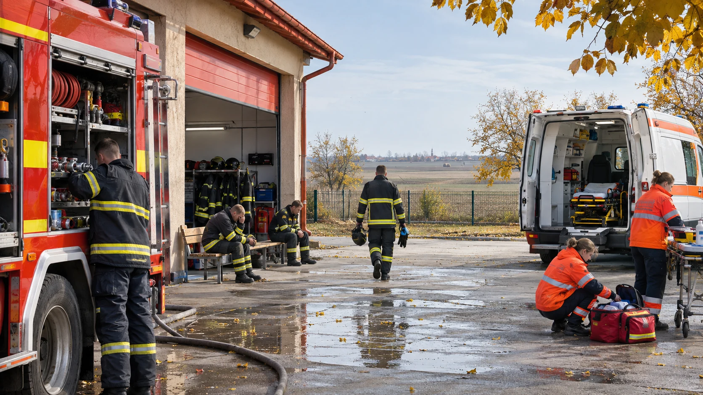

# Cinci incendii și trei accidente în bilanțul pompierilor teleormăneni

Potrivit instituției, misiunile au inclus stingerea a cinci incendii și intervenția la trei accidente rutiere.

## Datele comunicate de instituție

Separat, comunicatul precizează că o parte importantă a solicitărilor a fost reprezentată de cazurile medicale la care au intervenit echipajele de prim ajutor.

Din punct de vedere practic, pompierii militari teleormăneni au fost solicitați la 55 de situații de urgență în ultimele 72 de ore.

## Surse

- https://isutr.igsu.ro/comunicate-de-presa/in-ajutorul-cetatenilor-la-55-de-situatii-de-urgenta-943
