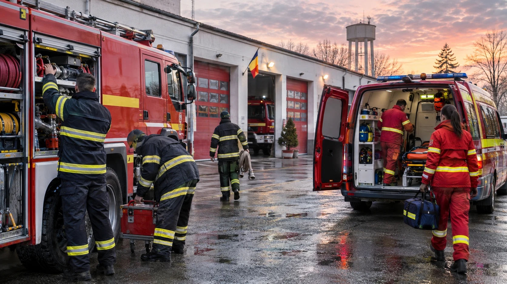

# Teleorman: 65 de intervenții ale pompierilor teleormăneni

Echipajele au intervenit și la un incendiu de locuință și trei accidente, iar inspectorii au făcut 15 controale de prevenire.

Echipajele de pompieri teleormăneni au gestionat 65 de situații de urgență în 72 de ore, majoritatea pentru acordarea primului ajutor.

## Surse

- https://isutr.igsu.ro/comunicate-de-presa/65-de-situatii-in-care-cetatenii-au-avut-nevoie-de-ajutorul-pompierilor-teleormaneni-945
