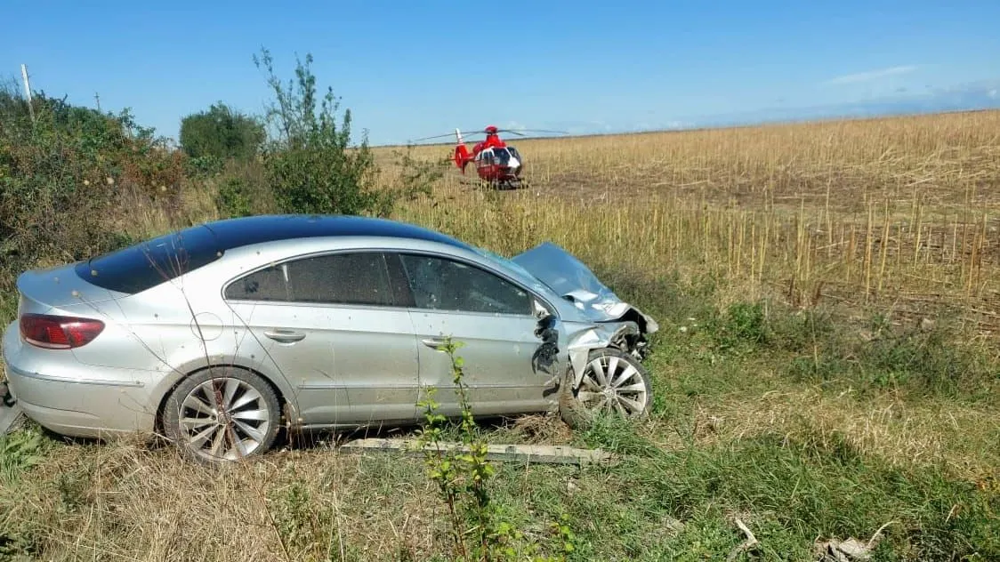

# Două autoturisme implicate într-un accident pe strada Alexandru Ghica; un bărbat a ajuns la spital

Cinci echipaje de salvare au fost mobilizate după coliziunea dintre două mașini pe strada Alexandru Ghica din municipiul Alexandria. Un bărbat de aproximativ 50 de ani a avut nevoie de transport la spital.

Dispozitivul a inclus descarcerarea și autospeciala de stingere ale pompierilor, o ambulanță SMURD și trei ambulanțe SAJ Teleorman. Comunicatul nu anunță alte persoane transportate.

## Ce nu este stabilit

Cauza impactului și conduita șoferilor nu sunt prezentate de ISU. Informațiile confirmate privesc locul, cele două autoturisme implicate și intervenția pentru persoana rănită.

## Surse

- https://isutr.igsu.ro/comunicate-de-presa/un-barbat-a-ajuns-la-spital-in-urma-unui-accident-rutier-produs-in-alexandria-935
