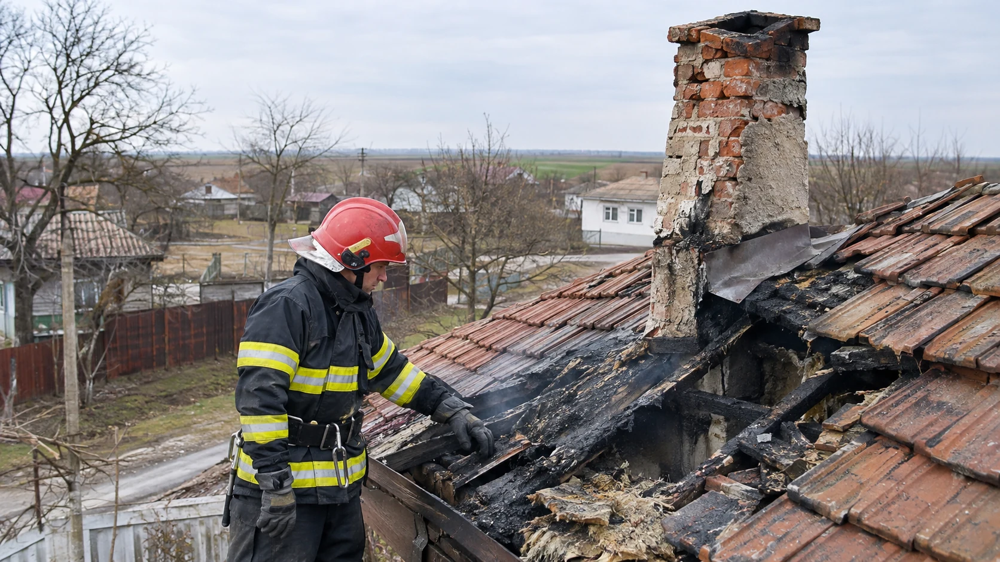

# 49 de intervenții SMURD și trei incendii în bilanțul de weekend al ISU Teleorman

Pompierii au intervenit la trei incendii — două în gospodării și unul la deșeuri menajere — și la două accidente rutiere, în Botoroaga și Alexandria. Două persoane au ajuns la spital.

## Informațiile oficiale

Potrivit inspectoratului, cauza probabilă a celor două incendii de locuință a fost lipsa protecției termice a coșurilor de fum față de materialele combustibile.

ISU Teleorman a raportat 57 de situații de urgență gestionate în 72 de ore. Echipajele SMURD au acordat primul ajutor în 49 de cazuri.

## Surse

- https://isutr.igsu.ro/comunicate-de-presa/doua-incendii-de-locuinte-aceeasi-cauza:-cosurile-de-fum-neprotejate-termic-954
