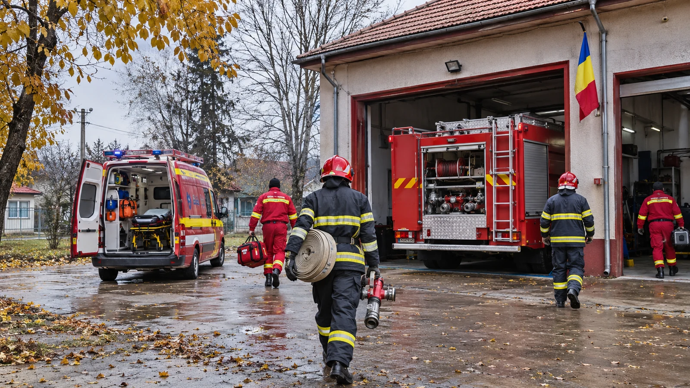

# 27 de intervenții ale pompierilor din Teleorman în 24 de ore — informațiile oficiale

Conform comunicării instituției, echipajele au stins și două incendii de locuință, la Spătărei și Dracea; cauza probabilă indicată în ambele cazuri a fost neprotejarea termică a coșurilor de fum. Au fost 17 misiuni SMURD și trei intervenții în sprijinul Serviciului de Ambulanță.

Conform comunicării instituției, bilanțul mai include un accident fără victime pe DJ 503, degajarea unui stâlp și a unui copac, deblocarea unei uși și măsuri preventive la un stâlp de electricitate.

Conform comunicării instituției, pompierii militari teleormăneni au gestionat 27 de situații de urgență în intervalul raportat, cele mai multe pentru acordarea primului ajutor.

## Surse

- https://isutr.igsu.ro/comunicate-de-presa/27-de-interventii-in-sprijinul-cetatenilor-in-ultimele-24-de-ore-955
