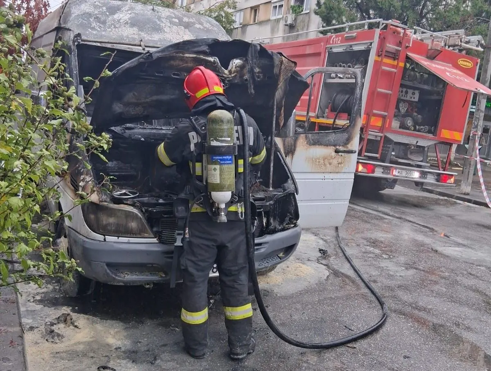

# ISU Teleorman a montat 498 de detectoare în 22 de localități; incendiile de locuință au scăzut cu 4,29%

Bilanțul ISU Teleorman indică 201 incendii de locuință în primele zece luni ale anului, față de 210 în 2025. Deși numărul a scăzut cu 4,29%, consecințele includ trei decese și 11 persoane rănite.

Pompierii au distribuit și instalat 498 de detectoare în gospodării din 22 de localități. Au fost alese în special case rurale construite înainte de anul 2000, încălzite cu combustibil solid sau locuite de copii, vârstnici și persoane cu dizabilități.

ISU reamintește că sobele și coșurile se verifică înainte de folosire, iar improvizațiile electrice trebuie eliminate de personal autorizat.

## Surse

- https://isutr.igsu.ro/comunicate-de-presa/prevenirea-incendiilor-de-locuinta-in-sezonul-rece-938
