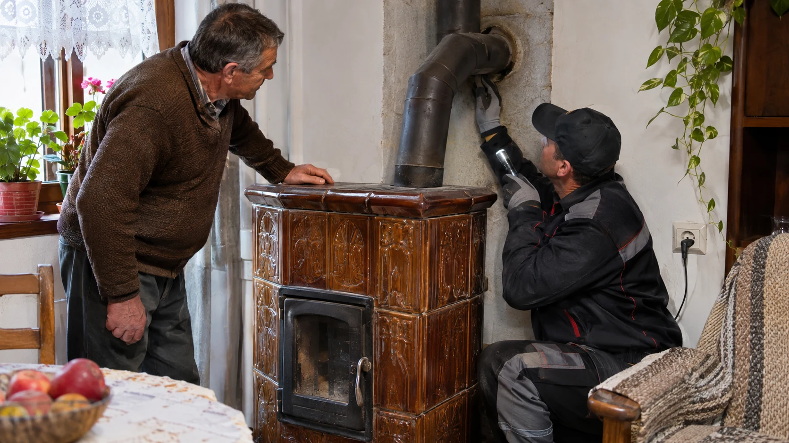

# Teleorman: pompierii teleormăneni cer verificarea sobelor și instalațiilor electrice

Actualizarea publicată de instituția competentă privește direct județul Teleorman.

Pompierii atrag atenția că un coș aparent în regulă, o sobă folosită de mulți ani sau un prelungitor solicitat zilnic pot ascunde defecțiuni care favorizează incendiile.

Deficiențele trebuie remediate la timp, cu ajutorul specialiștilor, iar instalațiile improvizate și echipamentele defecte nu trebuie folosite.

ISU Teleorman le recomandă locuitorilor să verifice sobele, coșurile de fum și instalațiile electrice înainte de folosirea intensă din sezonul rece. Informațiile ulterioare trebuie urmărite prin canalele oficiale ale instituției.

## Surse

- https://isutr.igsu.ro/comunicate-de-presa/cand-ati-verificat-ultima-data-soba-cosul-de-fum-sau-instalatia-electrica-din-locuinta-952
