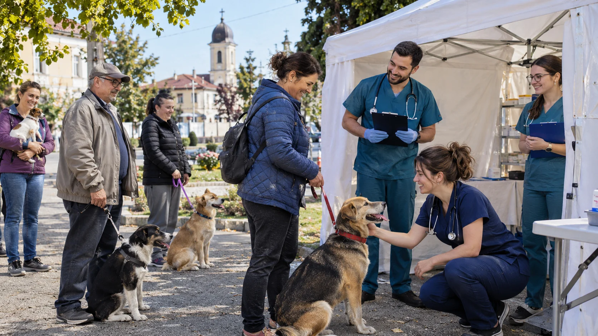

# Campanie gratuită de sterilizare a câinilor la Roșiori de Vede, pe 18 și 19 noiembrie

## Ce a anunțat instituția

Serviciul este oferit gratuit proprietarilor de câini.

Primăria Roșiori de Vede și Urbis Servconstruct sunt parteneri ai acțiunii.

## Date utile pentru public

Romania Animal Rescue și Center of Hope participă la organizare.

Campania se desfășoară în zilele de 18 și 19 noiembrie.

## Surse

- [Sursa oficială](https://www.primariarosioriidevede.ro/index.php/ro/component/content/article/9-anunturi/872-primaria-municipiului-rosiori-de-vede-in-parteneriat-cu-sc-urbis-servconstruct-rosiori-si-organizatiile-romania-animal-rescue-si-center-of-hope-anunta-desfasurarea-unei-noi-campanii-gratuite-de-sterilizare-a-cainilor-in-zilele-de-18-19-noiembrie-2026?Itemid=101)

