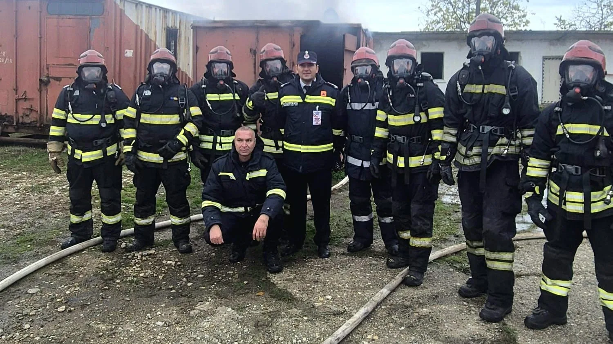

---
postFormat: 'text'
trending: true
title: "Teleorman: pompieri români și bulgari, exercițiu comun de intervenție la incendii în Videle"
excerpt: "Participanții au exersat tehnici de localizare și stingere a incendiilor, protecția personalului de intervenție și comunicarea dintre structurile celor două țări."
featureImg: /images/posts/videle-exercitiu-pompieri-romani-bulgari-eteleorman-12-noiembrie-2026.webp
thumb: /images/posts/videle-exercitiu-pompieri-romani-bulgari-eteleorman-12-noiembrie-2026.webp
date: Nov 12 2026
cate: 'Azi in Alexandria'
cate_bg: 'bg-color-red-one'
cate_img: '/images/category/world.png'
post_views: '0 Vizualizari'
post_share: '0 Shares'
author_name: 'Mara Ionescu'
author_desg: 'Publisher'
author_img: '/images/author/mara.png'
author_bio: 'Mara Ionescu este jurnalistă și editor la Azi în Alexandria, cu peste 10 ani de experiență în presa locală și în documentarea subiectelor care influențează viața comunității. Pasionată de poveștile oamenilor, de proiectele culturale și de dezvoltarea orașului, Mara scrie cu obiectivitate, empatie și atenție la detalii, oferind cititorilor informații clare, verificate și ușor de înțeles. Misiunea ei este să aducă Alexandriei o presă modernă, transparentă și orientată către nevoile reale ale locuitorilor.'
tags:
- Actualitate
- Știri locale

# Teleorman: pompieri români și bulgari, exercițiu comun de intervenție la incendii în Videle

Participanții au exersat tehnici de localizare și stingere a incendiilor, protecția personalului de intervenție și comunicarea dintre structurile celor două țări.

## Ce s-a întâmplat

Pregătirea a inclus scenarii practice și schimb de experiență între echipele operative. Astfel de exerciții sunt utile în intervențiile care necesită sprijin transfrontalier.

## Informațiile autorităților

Pompieri din România și Bulgaria au participat la Videle la o pregătire comună pentru intervenții la incendii. Exercițiul a urmărit coordonarea echipelor și folosirea acelorași proceduri operative.

## Ce urmează

ISU Teleorman a organizat activitatea la Videle și a prezentat-o drept o etapă de perfecționare a tehnicilor de intervenție.

## Surse

- https://isutr.igsu.ro/comunicate-de-presa/pregatire-comuna-la-videle:-pompierii-romani-si-bulgari-si-au-perfectionat-tehnicile-de-interventie-la-incendii-931

